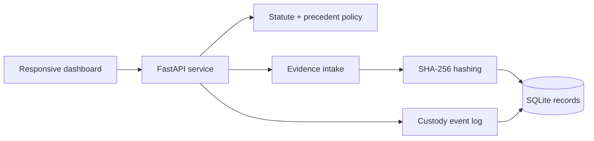

# Nyaya Integrity Console

> A transparent legal-technology prototype for judicial decision support, evidence integrity, and tamper-evident chain-of-custody workflows.

Nyaya Integrity Console is an interview-ready full-stack demonstration of how legal research, evidence handling, and human review can be organized into an auditable workflow. It is deliberately designed as a **decision-support system**, never an automated judge.

## Highlights

- Responsive case-workspace dashboard for judicial officers, clerks, investigators, and forensic teams
- FastAPI backend with live OpenAPI documentation
- SQLite persistence for cases, evidence records, human-review requests, and custody events
- SHA-256 evidence hashing at intake
- Hash-backed, append-only custody-event trail
- Deterministic IPC-to-BNS / CrPC-to-BNSS mapping records
- Precedent metadata and explainable legal-research views
- Evidence registration flow with browser-demo fallback and live API persistence
- Interactive case search, notifications, export, evidence preview, and legal graph dialogs
- Docker-ready local deployment

## Architecture



The detailed architecture and production upgrade path are available in [docs/ARCHITECTURE.md](docs/ARCHITECTURE.md).

## Tech Stack

| Layer | Technology |
| --- | --- |
| Frontend | HTML, CSS, vanilla JavaScript, Lucide icons |
| Backend | FastAPI, Pydantic, Uvicorn |
| Persistence | SQLite |
| Integrity | SHA-256 content and custody-event hashes |
| Deployment | Docker or local Python virtual environment |

## Run Locally

### Prerequisites

- Python 3.11+
- PowerShell on Windows, or equivalent shell commands on another platform

### Quick start

```powershell
cd "D:\Law system project"
.\run.ps1
```

`run.ps1` creates the virtual environment and installs dependencies on its first run. Then open:

- Dashboard: `http://127.0.0.1:8000`
- Interactive API docs: `http://127.0.0.1:8000/docs`

### Manual setup

```powershell
python -m venv .venv
.\.venv\Scripts\Activate.ps1
pip install -r backend\requirements.txt
uvicorn backend.main:app --reload --port 8000
```

## Working Pipelines

### Evidence registration

1. Choose **Evidence vault** in the dashboard.
2. Select **Register evidence** and choose a file under 5 MB.
3. The local API calculates a SHA-256 hash, persists metadata, and creates a custody event.
4. In hosted demo mode, the interface remains usable and stores the demonstration action in browser storage.

### Human review

Selecting **Request review** records a human-review request through the local API and adds an auditable event. The hosted demo provides the same visible workflow with browser-local state.

### Legal research

The project returns deterministic statute mappings and curated precedent metadata to demonstrate an explainable retrieval boundary. In a production system, this service would be replaced by a verified legal corpus and Neo4j-backed GraphRAG layer.

## API Example

Register evidence through the API:

```powershell
$payload = [Convert]::ToBase64String([Text.Encoding]::UTF8.GetBytes("sample evidence"))

Invoke-RestMethod -Method Post `
  -Uri "http://127.0.0.1:8000/api/cases/CR-2026-01842/evidence" `
  -ContentType "application/json" `
  -Body (@{
    filename = "investigator-note.txt"
    media_type = "text/plain"
    content_b64 = $payload
    submitted_by = "Demo Investigator"
  } | ConvertTo-Json)
```

Useful endpoints:

| Endpoint | Purpose |
| --- | --- |
| `GET /api/health` | Service and storage health check |
| `GET /api/cases` | List demo cases |
| `GET /api/cases/{case_id}/analysis` | Explainable decision-support record |
| `GET /api/cases/{case_id}/evidence` | Registered evidence metadata |
| `POST /api/cases/{case_id}/evidence` | Hash and register evidence |
| `GET /api/cases/{case_id}/custody` | Tamper-evident custody trail |
| `POST /api/cases/{case_id}/review-requests` | Record a human-review request |

## Docker

```powershell
docker build -t nyaya-integrity-console .
docker run --rm -p 8000:8000 nyaya-integrity-console
```

## Repository Layout

```text
backend/             FastAPI application and dependency list
dist/                Responsive dashboard
docs/                Architecture notes and interview demo script
run.ps1              Local development launcher
Dockerfile           Container configuration
```

## Responsible Use

This project does **not** determine bail, sentencing, guilt, innocence, or the admissibility of evidence. Its analysis is deterministic demonstration data, its forensic signal is illustrative, and every outcome requires competent human review. Real deployment would require validated datasets, legal-governance review, bias testing, access controls, model cards, cryptographic key management, and jurisdiction-specific compliance.

## Interview Demo

Use [docs/DEMO_SCRIPT.md](docs/DEMO_SCRIPT.md) for a concise three-minute walkthrough and suggested interview framing.
