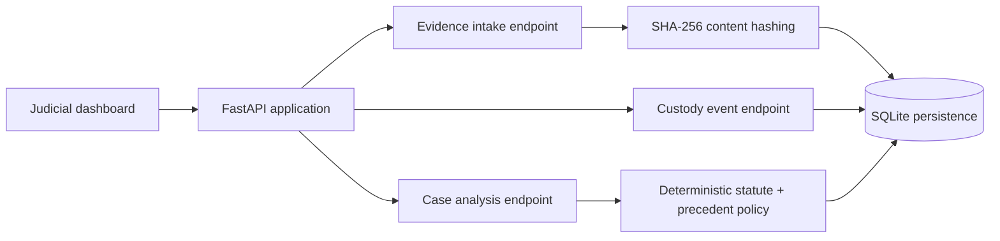

# Architecture: Nyaya Integrity Console

## Pipeline walkthrough

1. A user submits base64-encoded evidence to `POST /api/cases/{case_id}/evidence`.
2. The service validates the payload, calculates SHA-256, and saves evidence metadata.
3. A custody event is written with a separate event hash, actor, timestamp, and message.
4. The dashboard can retrieve the evidence list and event history through read-only API routes.
5. A case-analysis route returns deterministic IPC-to-BNS links and pre-curated precedent metadata. Its result is explicitly labelled as decision support requiring human review.

## Production upgrade path

| Demo component | Production replacement |
| --- | --- |
| SQLite | PostgreSQL with encrypted backups and point-in-time recovery |
| In-process policy data | Neo4j legal knowledge graph plus curated statute/precedent corpus |
| SHA-256 event records | Hyperledger Fabric, HSM-backed signatures, and scheduled public anchors |
| Static forensic signal | Isolated GPU inference service with model registry and explainability artifacts |
| Local FastAPI process | Container deployment behind API gateway, RBAC, and audit monitoring |

## Safety boundary

The project demonstrates records, retrieval, integrity checks, and explainable workflow states. It must not make bail, sentencing, guilt, innocence, or admissibility decisions without a competent human authority.
